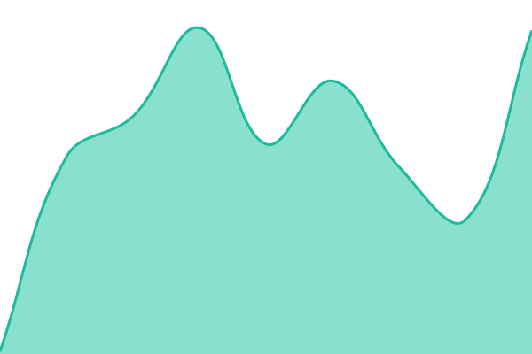

# [📈 Live Status](https://status.camtoan.me): <!--live status--> **🟩 All systems operational**

This repository contains the open-source uptime monitor and status page for [camtoando](https://status.camtoan.me), powered by [Upptime](https://github.com/upptime/upptime).

With [Upptime](https://upptime.js.org), you can get your own unlimited and free uptime monitor and status page, powered entirely by a GitHub repository. We use [Issues](https://github.com/camtoan-do/status/issues) as incident reports, [Actions](https://github.com/camtoan-do/status/actions) as uptime monitors, and [Pages](https://status.camtoan.me) for the status page.

<!--start: status pages-->
<!-- This summary is generated by Upptime (https://github.com/upptime/upptime) -->
<!-- Do not edit this manually, your changes will be overwritten -->
<!-- prettier-ignore -->
| URL | Status | History | Response Time | Uptime |
| --- | ------ | ------- | ------------- | ------ |
|  [Website](https://camtoan.me) | 🟩 Up | [website.yml](https://github.com/camtoan-do/status/commits/HEAD/history/website.yml) | 

 230ms
     
 | 

<a href="https://status.camtoan.me/history/website">100.00%</a>
    

|  [Blog](https://camtoan.me/blog/) | 🟩 Up | [blog.yml](https://github.com/camtoan-do/status/commits/HEAD/history/blog.yml) | 

 144ms
     
 | 

<a href="https://status.camtoan.me/history/blog">100.00%</a>
    

|  [About](https://camtoan.me/about/) | 🟩 Up | [about.yml](https://github.com/camtoan-do/status/commits/HEAD/history/about.yml) | 

 109ms
     
 | 

<a href="https://status.camtoan.me/history/about">100.00%</a>
    

|  [security.txt](https://camtoan.me/.well-known/security.txt) | 🟩 Up | [security-txt.yml](https://github.com/camtoan-do/status/commits/HEAD/history/security-txt.yml) | 

 160ms
     
 | 

<a href="https://status.camtoan.me/history/security-txt">100.00%</a>
    

<!--end: status pages-->

[**Visit our status website →**](https://status.camtoan.me)

## 📄 License

- Powered by: [Upptime](https://github.com/upptime/upptime)
- Code: [MIT](./LICENSE) © [Anand Chowdhary](https://anandchowdhary.com)
- Data in the `./history` directory: [Open Database License](https://opendatacommons.org/licenses/odbl/1-0/)
